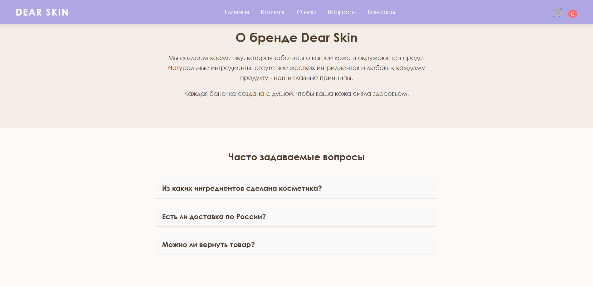
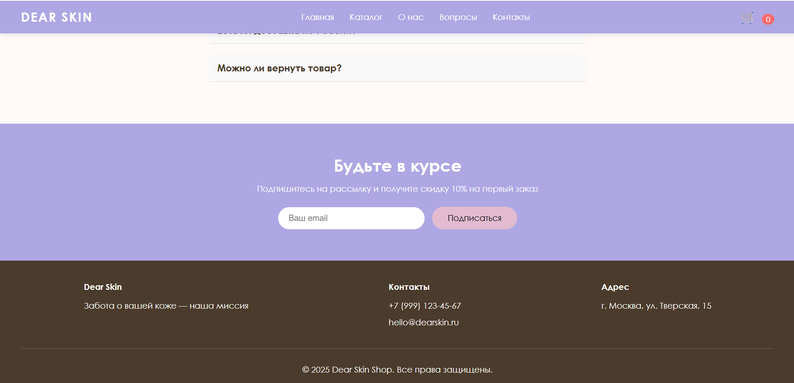

# Dear Skin — магазин уходовой косметики

Одностраничный сайт-магазин с каталогом товаров, интерактивной корзиной и плавной навигацией. 

## Скриншоты
Главная

Каталог

Корзина

О нас & FAQ

Футер


## Стек
- HTML5
- CSS3
- JavaScript

## Что реализовано

### UI/UX и верстка
- Разработка концепции и дизайна магазина косметики
- Верстка шапки сайта и базовой структуры страницы
- Адаптивная сетка каталога товаров

### JavaScript
- Рендеринг карточек товаров из массива данных
- Добавление товаров в корзину, удаление и изменение количества
- Динамический подсчет итоговой суммы и общего количества товаров
- Боковая панель корзины
- Обработка формы подписки на рассылку
- 
## Клонирование репозитория
git clone https://github.com/anarkulovab/skincare-shop-page-web.git

## Структура проекта
```text
dear-skin-shop/
├── css/
│   └── index.css
├── js/
│   └── index.js
├── index.html
└── README.md
